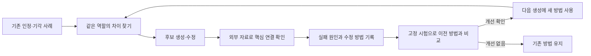

# DA 기획 자가학습 — GPT 독립 설계안

## ① 한 줄 요약

**대표가 인정한 기획과 기각한 기획의 차이를 학습 재료로 삼고, AI가 사실을 확인하고 실패 원인을 찾아 다음 기획의 만드는 방법을 고치게 하자.**

추천하는 것은 **검증 가능한 부분부터 스스로 개선하는 기획 시스템**이다. 규칙을 계속 늘리거나 두 모델의 합의를 정답으로 삼는 방식에서, 좋은 사례의 구조를 재사용하고 틀린 연결을 실제 근거로 교정하는 방식으로 옮긴다.

대표가 매번 오답 이유를 설명하지 않아도 돌아가게 만들 수 있다. 다만 대표가 아직 보지 않은 새 기획을 마음에 들어 할지는, 대표의 반응을 전혀 받지 않고 확정할 수 없다. 그 한계를 이유로 멈추지 않고, 이미 확보한 선호를 충분히 활용하고 자동으로 검증할 수 있는 오류를 먼저 줄인다.

이 문서는 설계 제안이다. **4차 제품 기획은 보류 상태를 유지한다.** 코드·수집·자동 실행·모델 학습을 시작하지 않았고, 정본 규칙·raw·Claude 문서를 수정하지 않는다. Claude의 자가학습 설계안은 읽지 않고 작성했다. 아래의 일정·배치 크기·승격 조건은 GPT 제안이며 대표가 확정한 판례가 아니다.

## ② 대표 없이 ‘좋은 기획’을 알려 주는 신호와 그 검증

### 목표를 세 개로 구분한다

| 알고 싶은 것 | 확인할 수 있는 것 | 확인할 수 없는 것 |
|---|---|---|
| 대표가 원하는 기획인가 | 기존 인정·기각 사례와의 조건부 일치 | 처음 보는 조합에 대한 대표의 최종 선택 |
| 실제로 만들어지고 작동할 것인가 | 실제 원료·부품·사용 동작·조달 자료, 기존 제품과의 차이 | 샘플 없이 최종 제형·체감·효과 |
| DA로 사업이 될 것인가 | 대표 키워드, 기존 경쟁 제품, 가격·원가 가정, 광고·시장 추이 | 집행 전 우리 ROAS·재구매·실제 이익 |

한 숫자로 섞지 않는다. **대표 취향, 사실 성립, 사업 가능성의 근거를 따로 기록한다.** 사실이 틀린 안은 고칠 수 있어도, 시장에서 팔리는 흔한 제품을 대표가 좋아하는 새 기획의 정답으로 바꿀 수는 없다.

### 자동으로 쓸 신호

| 신호 | 어디서 얻나 | 무엇을 고치나 | 정답으로 쓰면 안 되는 것 |
|---|---|---|---|
| 기존 대표 판정 | 기획 원문＋실제 판정＋당시 조건 | 상징의 담당 역할·이식 방법·허용 수준 | 한 기각을 모든 카테고리 금지로 일반화 |
| 대표가 인정한 좋은 기획 | 쏘모카·써모드·유쎄라블·GLP-1 지엘 등의 인정 원문 | 기획의 구조와 요소 사이 연결 | 과거에 좋았던 원료가 지금도 참신하다는 판정 |
| 확인 가능한 사실 | 공식 원료·제품 자료, 전성분, 가격, 작동 방식 | 조달 불가능·잘못된 코어·저가 대안·사용 수고 | 판매자의 광고 주장＝우리 제품의 효능 |
| 시장의 실제 표현 | 광고·상품·고객이 쓰는 대표어와 장면 | 시장·상징·고객 언어의 해부 방법 | 오래 돈 광고＝매출·대표 선호·우리 성공 |
| 고정된 비교 시험 | 동일 입력·동일 예산으로 만든 이전/수정 방법의 결과 | 다음 생성에 쓸 조사 순서·예시·작업 절차 | 내부 점수가 올랐다는 사실만으로 좋은 기획 확정 |

**대표 선호는 기존 판정에서 배운다. 시장 자료에서는 구매 욕구·표현·사용 장면을 배운다. 두 자료를 같은 라벨로 합치지 않는다.**

예를 들어 찹쌀은 쏘모카에서 쫀득함을 설득하는 역할이다. 찹쌀이 털 제거 성능을 높인다는 실험이 없다는 이유로 그 상징까지 지우면, 상징과 실제 결과를 다시 혼동한다. 반대로 찹쌀이 들어 있다는 이유로 제거 성능이 검증됐다고 쓰는 것도 오류다. 자동 평가는 ‘어떤 주장을 담당하나’부터 확인한다.

### 검증의 기본 단위는 판례 문장 수가 아닌 ‘기획 한 건’이다

과제 요약은 판례 802건·시장 광고 카드 8,486장·60일 이상 상품 묶음 721개·해부 39개를 제시한다. 문장 여러 개가 같은 기각 한 건에서 나왔거나 광고 여러 장이 같은 상품을 가리킬 수 있다. 자료량을 독립적인 정답 수로 부풀리지 않는다.

각 기획에 `대표 판정 / 시장 관찰 / 모델 해석 / 미확인`을 따로 붙인다. 인정 사례도 ‘대표 본인 기획’, ‘대표가 인정한 타사 사례’, ‘AI가 시장 히트라고 분류한 사례’를 구분한다. 좋은 사례의 정확한 수는 중복과 인정 수준을 정리한 뒤 확정한다.

### 지금의 숫자를 정확히 읽기

| 기록 | 정확한 단위 | 자가학습 설계에서의 의미 |
|---|---|---|
| 2차 | 생성 30건, 대표 판정 6건, 진행 0/6 | 내부 추천이 대표 선택과 어긋남. 미판정 24건은 실패 정답이 아님 |
| 3차 | 제출·판정 10건, 기각 8＋보류 2 | '안 함'만 맞히면 10/10. 네 단계 판단과 이유를 따로 측정해야 함 |
| 3차 예측 | Claude 다수결 8/10·GPT 8/10, 협의 뒤 8·7/10 | 합의와 왕복 자체가 개선 신호라는 가정은 반박됨 |
| 현재 회귀 | 61건에서 채점자별 59·60건 일치 | 이미 규칙에 흡수한 판정의 재현. 새 기획 능력 아님 |
| 긍정 회귀 | 같은 61건 중 양성 11건, 10·11건 보존 | 좋은 안을 죽이는 과잉 엄격화를 별도로 감시할 필요 |

회귀 61건은 A13＋B34＋G4＋N10이다. 판정의 이진 합치기 때문에 보류도 음성에 들어간다. 회귀 기록의 '39/40'은 A·B 음성 부분이며 61건 전체 음성 성능이 아니다. G·N도 규칙 반영 뒤의 재시험이다. 현재 바로 쓸 수 있는 미사용·비노출 대표 판정은 지정 범위에서 확인되지 않았다. 그러므로 대표 시간 0 실험은 사실 검증·기존 선호 적용의 개선만 측정한다.

출처: 공동기획-2026-10-2차/아침-보고.md 및 판례목록 P6136~P6147, 공동기획-2026-10-3차/결과-3차.md §1~2, 기획-시스템/작업/시뮬레이션/회귀시험.md. 현재 감사에서 분모·라벨을 대조한 결과이며, 같은 대상을 채점한 두 모델을 독립 정답 두 배로 세지 않는다.

## ③ 학습 고리 — 무엇이 어디에 쌓이나

### 핵심은 ‘새 규칙’보다 ‘다음에 다르게 할 행동’을 남기는 것이다

현재 모델의 가중치를 이 대화에서 바꾸는 작업은 아니다. **지속해서 남는 사례·작업 절차·검색 순서·예시를 바꾸어 다음 호출의 행동을 개선한다.** 이를 가중치 학습이나 완전한 E2E 모델이라고 부르지 않는다.

### 한 번의 고리

1. **정답과 조건을 먼저 묶는다.** 원문·당시 기획·타겟·담당 역할·판정 시점·상징 포화 시점을 함께 둔다. 최신 대표 판정이 옛 판정을 대체한 경우도 표시한다.
2. **비슷한 성공과 실패를 함께 꺼낸다.** ‘열감 제품’이라는 이름이 아니라 ‘어떤 상징을 어떤 역할로 옮기려 했는가’로 찾는다. 좋은 사례 하나와 반례 하나를 함께 제공한다.
3. **생성 단계부터 그 차이를 반영한다.** 완성 기획서부터 쓰지 않는다. 결핍·고객이 원하는 대안·공개 이미지·제품에 옮길 실제 칸을 먼저 연결하고, 치명적 빈칸이 있으면 그 칸부터 조사한다.
4. **점수 대신 가장 위험한 연결을 검증한다.** ‘찌릿함이 울쎄라 코어인가’, ‘이 고객이 스컬트라의 우유색을 알고 있나’, ‘2천 원 동일 기능 대안이 있나’처럼 기획을 무너뜨리는 질문 하나를 정한다. 직접 자료로 답하지 못하면 미확인으로 남긴다.
5. **실패 원인을 AI가 쓴다.** 누락된 조사인지, 잘못된 사실인지, 상징 역할 오판인지, 사용 수고인지, 참신성인지 구분한다. 수정한 부분과 고치지 않은 부분을 함께 남긴다.
6. **만드는 방법을 하나만 바꿔 비교한다.** 검색 순서·비교 예시·코어 해부 양식 중 하나를 바꾼다. 규칙·예시·채점 기준을 동시에 바꾸어 무엇이 좋아졌는지 모르게 만들지 않는다.
7. **시험에서 나아졌을 때만 다음 생성에 쓴다.** 기존 인정 사례를 새로 탈락시키거나 사실 오류가 늘면 이전 방법으로 되돌린다. 대표 취향에 관한 새 추정은 시험을 거쳐도 ‘대표 확인 전 가설’로 남긴다.

### 실제로 학습할 내용의 예

| 관측한 실패 | 다음 생성에서 바꾸는 행동 | 바꾸지 않는 것 |
|---|---|---|
| 울쎄라를 찌릿함 한 가지로 옮김 | 원리·고객이 보는 장면·대표 체감을 먼저 대조하고 이식 가능한 칸을 확인 | 모든 체감 상징을 금지하지 않음. 써모드의 인정 조건을 함께 보존 |
| 스컬트라의 밀크색에 의미를 부여 | 제조 원리 설명과 고객이 실제 보는 모습을 구분해서 조사 | 바이알·주사기 같은 공개 이미지와 색소 성분을 혼동하지 않음 |
| 우레아 기획이 다이소 대안에 짐 | 기획 확장 전에 동일 기능의 저가 대안부터 확인 | 가격만으로 모든 프리미엄 기획을 금지하지 않음 |
| 매일 점을 찍게 하는 제품 | 사용 횟수·필요 동작·누가 하는지를 원래 대안과 나란히 비교 | 횟수 기준을 임의의 하드 규칙으로 만들지 않음 |
| 흔한 효능 제품을 히트라는 이유로 추천 | ‘시장에서 팔림’과 ‘우리가 낼 새 구매 이유’를 다른 칸으로 평가 | 시장 수요 근거까지 버리지 않음 |

이것은 반성문을 더 잘 쓰는 고리가 아니다. **수정 행동을 다음 생성에 실제로 넣고, 동일 조건에서 오류가 줄었는지 확인하는 고리**다.

### 개선이 다음 호출에 실제로 적용되는 계약

승격 대상은 판정 규칙이나 반성문이 아니라 **버전이 붙은 실행 방법 한 개**다. 최소 내용은 적용 조건, 사용할 성공/실패 사례 ID, 생성 전 확인할 질문, 지시문 변경분, 검사할 근거, 되돌릴 이전 버전이다.

향후 구현에서 매 시도는 다음 값을 저장한다.

`attempt_id / active_method_id / method_hash / rule_commit / case_ids / source_ids / rendered_input_hash / initial_output / verified_final_output / error_and_missing_slots / tokens`

입력 본문도 시도 기록에 보존한다. 다음 생성의 시작 단계가 활성 방법을 읽고 관련 사례를 실제 입력에 넣어야 한다. 버전명만 남기고 입력에 예시가 빠졌다면 적용 실패다. 상한 때문에 자료를 줄였으면 빠진 사례도 기록한다. 상대 모델이 한 평가를 그대로 새 규칙으로 넣지 않는다.

시험의 승격 결정이 난 뒤에만 활성 방법 포인터를 새 버전으로 바꾸며 이전 버전·입력·결과는 보존한다. 실패하면 포인터를 이전 버전으로 돌린다. 정본의 🔒·📊·🧪와 별개의 작업 절차 실험으로 유지한다. 정본 수정 권한은 ⑩-05·⑩-13을 따른다. 현재는 이 계약의 설계만 작성했고 포인터·실행 파일을 만들지 않았다.

### 자료가 쌓일 자리 — 향후 구현안

새 정본을 만들지 않는다. 위키는 기준, 프로젝트는 실험과 작업 기록으로 유지한다.

| 자료 | 향후 보관 위치·내용 |
|---|---|
| 대표 원문 | 기존 raw/본인/. 불변 유지. AI 해석을 대표 원문처럼 쓰지 않는다 |
| 기획 사례 목록 | 기획-시스템/작업/자가학습/사례목록: 기획 ID·출처·판정·조건·중복 관계 |
| 성공/실패 비교 | 같은 폴더의 대비사례: 실제 판정과 AI 해석을 별도 필드로 저장 |
| 시도 기록 | 입력 자료 버전·생성 결과·검증 근거·수정 한 가지·토큰·결과 |
| 실행 방법 버전 | 기존 da-planning 패키지의 절차·참고 예시를 가리키는 버전 목록. 우선 시험용으로 분리 |
| 고정 시험 | 개발용 사례와 채점용 사례를 상품·브랜드·상징 조합 단위로 분리한 목록 |
| 승격/되돌림 | 어떤 시험에서 이전 방법보다 나아졌는지 기록. 근거 없이 ‘학습 완료’ 처리 금지 |

위 목록은 설계다. 이번에 이 폴더나 파일들을 생성하지 않는다. 실제 구현에서는 기존 SKILL.md·references·scripts 구조에 연결하고 별도 시스템을 중복 구축하지 않는다.

## ④ 대표 역할 — 전과 후

| 지금 | 바꿀 방식 |
|---|---|
| 기각 이유를 대표가 계속 설명 | AI가 원문과 사실 자료로 실패 원인·수정안을 먼저 작성 |
| 대표가 각 규칙을 추가 | 기존 판례의 적용 조건을 AI가 재사용. 새 행동 절차는 시험으로 개선 |
| 모델 둘이 갈리면 매번 질문 | 사실 충돌은 자료로 해결. 선호 충돌은 ‘미확인’으로 보관 |
| 여러 완성안과 부가 설명을 읽음 | 대표가 볼 때는 제품·타겟·쓰는 법·가격의 네 줄과 가장 중요한 차이만 표시 |

**첫 실험에 대표의 판정이나 오답 설명을 요구하지 않는다.** 기존 판정으로 학습·시험을 먼저 한다.

나중에 대표가 평소처럼 “이쪽이 낫다”, “둘 다 별로”, “진행”이라고만 답해도, 모델은 그 결과를 기록하고 원인을 조사할 수 있다. 이유 설명은 필수가 아니다. AI가 붙인 이유는 반드시 ‘추정’으로 남긴다. 둘 중 하나가 더 낫다는 선택을 생산 승인·규칙 변경 승인으로 확대하지 않는다.

모르는 취향은 모르는 채로 둔다. 대표에게 물을 기회가 생기면 이미 아는 기각 사례를 다시 묻지 않고, 비슷해 보이지만 한 요소가 다른 두 안 중 어느 쪽을 원하는지 확인한다. 단, 이를 정기 숙제나 주간 O/X 요구로 만들지 않는다.

정본 ⑩-01·⑩-05에는 사람 판정의 역할과 🔒 판례 보호가 남아 있다. 본 설계는 **대표 설명 노동을 줄이는 제안**이며, 두 모델이 대표 판례를 자동 변경하는 권한을 만드는 것이 아니다. 필요한 절차 변경은 제안으로만 남긴다.

## ⑤ 보상 해킹 — 내부 점수만 좋아지는 것을 막는 법

### 합격률을 올리는 것과 기획을 좋게 만드는 것은 다르다

2차는 30개를 생성했지만 대표가 판정한 추천은 6개이고, 그 6개에서 진행은 0건이었다. 나머지 24개를 대표 기각으로 라벨링하면 안 된다. 3차는 10개 중 기각 8건·보류 2건이었다. 보류 2건의 좋은 접근까지 기각과 동일하게 학습하지 않는다. 3차에서 전부 진행 불가라고만 답하면 ‘진행 여부’는 10/10이다. 반면 좋은 기획을 만들어 내는 능력은 전혀 증명하지 못한다.

따라서 다음 장치를 둔다.

- **긍정·부정 시험을 분리한다.** 기존 좋은 기획을 살리는지와 기존 치명적 결함을 잡는지를 각각 표시한다. ‘전부 탈락’은 긍정 시험에서 실패한다.
- **합의는 정답 라벨이 아니다.** Claude와 GPT가 모두 좋다고 해도 근거가 같은 추정이면 미확인이다. 정본의 ⑩-11 ‘같으면 확정’은 이 설계에서 바꿔야 할 기본값 후보다. 이번에 정본을 고치지는 않는다.
- **검증기의 기준을 생성 결과에 맞춰 고치지 않는다.** 수정 방법을 시험하기 전에 질문·정답 근거·판정 기준을 고정한다. 두 모델이 시험 문제와 해답을 함께 바꾸게 하지 않는다.
- **잘 쓰인 글의 점수를 기획 점수로 바꾸지 않는다.** 모델명·작성자를 숨기고 같은 네 줄 형식으로 비교한다. 장문·확신·자기 설명 때문에 좋은 기획처럼 보이는 효과를 줄인다.
- **좋은 사례의 한 조건만 바꿔 민감도를 본다.** 같은 기획에서 실제 원료 조달 근거를 없애거나, 필요한 동작과 다른 동작으로 바꿨을 때 평가가 반응해야 한다. 단, 이런 변형의 새 대표 선호 라벨을 AI가 확정해서는 안 된다. 확인 가능한 사실·명시 조건을 어겼는지 시험하는 용도다.
- **싼 대안·순서·이름의 반증을 붙인다.** 그 제품의 진짜 가치를 이름만으로 덮고 있나, 알려진 시술의 핵심이 빠졌나, 더 편한 저가 제품이 같은 기능을 이미 하나를 조사한다. ‘이름 지우기’를 모든 인정 제품의 하드 조건으로 만들지는 않는다.
- **빈칸은 빈칸으로 남긴다.** 조달·효능·견적·인지도가 미확인이면 AI 문장으로 채워 넣지 않는다. 빈칸 수를 줄인답시고 출처 없는 사실을 발명하면 실패다.
- **시장 신호와 시간의 한계를 보존한다.** 여러 광고 계정이 같은 판매 회사면 독립 히트로 중복 세지 않는다. 처음부터 짧게 관측된 광고나 사라진 광고를 자동 실패로 학습하지 않는다. GLP-1처럼 예전의 좋은 기획이 현재 흔해졌다는 사실은 시점 조건으로 저장한다.

**자료 누수도 성능 착각이다.** 이미 규칙을 만든 데 쓴 61건에서 59~60건을 맞히는 것은 회귀 확인일 뿐 새로운 기획 성능이 아니다. 같은 상품의 광고·서브브랜드·문구 변형을 학습/시험으로 나누어도 독립 시험이 아니다. 기존 규칙에 판정이 간접적으로 들어가 있으면, 판정 원문만 가려도 진짜 미사용 시험이 되지 않는다.

자동으로 만든 대비사례는 설명·검증 도구다. 실제 대표 판정이나 새 고객 반응을 대신하는 데이터로 부풀리지 않는다.

## ⑥ Claude·GPT 역할 — 서로 다른 신호를 내게 하는 방법

모델명이 다르다는 이유만으로 독립적인 판단 두 개가 생기지는 않는다. 같은 규칙·같은 예시·같은 추정 설명을 주면 함께 틀릴 수 있다.

추천하는 분업은 **한쪽은 만드는 방법을 제안하고, 다른 쪽은 그 방법의 핵심 연결을 외부 근거로 깨 보는 것**이다. 고정된 우열이나 영구 역할은 아니다.

| 역할 | 맡을 일 | 먼저 보지 않을 것 |
|---|---|---|
| 생성 담당 | 기존 긍정·부정 사례의 차이를 적용해 가장 짧은 후보를 만들고 변경점 기록 | 상대의 점수·반성문·추천 결론 |
| 검증 담당 | 동일 기획의 원료·사용 동작·고객 장면·저가 대안을 직접 대조. 가장 강한 반례 하나 확보 | 작성 모델명·자기 점수·‘이것은 좋은 기획’이라는 설명 |
| 시험 담당 | 고정된 사례에서 이전/수정 방법 결과를 같은 기준으로 비교 | 기준을 수정할 권한, 개발용 실패를 시험 정답으로 만드는 권한 |

Claude 혼자 할 때의 맹점은 **자신이 만든 규칙의 의미를 자신이 만든 기획에 유리하게 읽고, 그 점수를 다시 학습 근거로 삼는 것**이다. GPT 혼자도 같은 문제가 있다. GPT를 붙여도 단순 재채점이면 이 문제가 해결되지 않는다.

기획의 사실 검증용 입력은 생성 담당이 쓴 설득문보다 **기획의 네 줄·실제 원료/외형/동작·원본 출처**를 중심으로 준다. 예컨대 한쪽이 피부과 시술 설명을 읽었다면 다른 쪽은 소비자가 실제 보는 상품·시술 장면과 저가 대안을 본다. 자료 경로를 다르게 하고 서로의 결론을 읽기 전에 기록한다.

첫 비교에서는 Claude 생성→GPT 검증과 GPT 생성→Claude 검증을 작은 표본에서 교대한다. 단독 두 번과 협업 두 번의 호출 수를 맞춘다. 협업이 아니라 조사량 증가 덕분에 나아진 결과를 구분하기 위해서다.

분업 결과는 고정 시험을 본 뒤 정한다. 현행 ⑩-16처럼 몇 번 더 작업해 강점을 비교한다는 취지는 유지한다. 서로의 합의만으로 역할을 확정하지 않는다.

브리지는 요청 하나에 결과 하나를 보내고, 기본적으로 후속 답변을 요구하지 않는다. 자료 확인→수정 한 번 뒤에도 취향이 불명확하면 멈춘다. AI끼리 합격 판정을 얻으려고 계속 왕복하지 않는다.

## ⑦ 첫 실험 — 대표 시간 0, 이틀 안에 확인할 것

**새 제품 5개를 다시 기획하는 실험부터 하지 않는다.** 기존 기획을 해부·복원·교정하는 작은 실험으로, 새 절차가 알려진 오류를 실제로 줄이는지 먼저 본다. 4차 보류와 충돌하지 않게 이번에는 실험 계획만 제시한다.

### 비교할 방법

| 방법 | 입력·절차 | 알아볼 것 |
|---|---|---|
| A: 현재 방식 | 같은 버전 규칙＋같은 시장 자료. 한 모델 생성 후 자기검토 | 기준선 |
| B: 대비사례 방식 | A＋같은 역할의 인정/기각 사례. 한 모델 생성 후 자기검토 | 사례를 넣은 효과 |
| C: 같은 절차＋교차 모델 | B와 같은 예시·반증 자료·조사 절차·호출 수. 검토 모델만 교체 | 검토 모델 교체의 추가 효과 |

네 줄 출력, 조사 가능한 자료, 호출 수·최대 길이를 맞춘다. A/B/C 모두 같은 위험 질문·반증 절차·원본 자료 패킷을 사용한다. A와 B의 차이는 대비사례 제공이고, B와 C의 차이는 두 번째 호출의 모델뿐이다. 이번 실험에서는 새 웹 검색으로 한 방법만 더 많은 정보를 얻지 않게 하고, 기존 조사와 확인된 공개 출처를 같은 범위로 제공한다. 검증 담당이 받는 것은 생성 담당의 자기 점수·설득문이 아닌 실제 출력과 원본 출처다. 모델 버전·규칙 커밋·입력 자료·출력 순서·토큰을 기록한다. 네 시험 사례 중 두 개는 Claude 생성, 두 개는 GPT 생성으로 고정해 모든 방법에서 같은 생성 담당을 유지한다.

### 준비·실행

**첫날: 자료 정리와 수정 방법 한 개.**

- 기존 명확한 인정 4건·기각 6건·조건부 3건·보류 3건을 중복 없이 묶어 **회귀 확인 16건**을 만든다. ‘괜찮음’, ‘보류’, ‘진행’의 라벨은 합치지 않는다. 실제 원문에서 해당 인정 수준이 확인되지 않으면 정답군에 넣지 않는다. 출력은 원문의 진행 가능·조건부·보류·기각을 구분하고, 실제 발주·출시 여부는 별도 필드다. 사례의 당시 시점을 고정한다. GLP-1 지엘의 과거 기획 인정과 현재 포화를 섞지 않는다.
- 비교용 시장 해부 12개를 상품·브랜드 단위로 묶는다. 대표가 인정한 사례와 시장에서 관측한 사례를 표시한다.
- 8개는 작업 방법을 고치는 데 쓰고, 4개는 그 방법을 고른 뒤 채점하는 데만 쓴다. 원본의 한 요소를 가리고 공개 자료로 복원하게 한다. 같은 기획의 광고 변형은 양쪽에 넣지 않는다.
- 이 4개를 과거 두 모델이 전혀 본 적 없다고 주장하지 않는다. **이번 실험 안의 분리**이며, 대표의 새 기획 선호를 검증하는 진짜 독립 시험은 아니다.
- 첫 수정은 성공/실패 대비사례를 생성 전에 제공하는 한 가지로 고정한다. 가장 위험한 연결부터 조사하는 순서는 A/B/C에 공통 적용한다. 예시 추가와 조사 순서를 함께 바꿔 효과를 혼합하지 않는다.

**둘째 날: 동일 입력으로 A/B/C를 비교한다.**

- 작업용 8개 전체를 계속 재생성하지 않는다. 개선 방법은 1회만 수정한다.
- 채점용 4개를 방법 3개로 복원·교정한다. 첫 호출은 최초안, 두 번째 호출은 사실 검증＋필요한 교정＋최종 네 줄을 한 번에 출력한다. 총 24회 호출이며 별도의 세 번째 교정 호출은 없다. 최초안도 보존하되 승격의 비교 대상은 세 방법 모두 두 번째 호출의 최종안이다.
- 호출 배분은 수정 방법 제안 1회＋생성/검증/교정 24회＋회귀 묶음 평가 3회＋사례별 최종 비교 4회＋같은 비교의 순서 교환 4회＝최대 36회다. 집계·보고는 저장 결과로 만들어 추가 모델 호출을 하지 않는다. 최종 비교는 A/B/C의 작성자와 방법명을 가리고 고정된 원본 근거로 수행한다. 순서를 바꿔도 갈리는 사실 판정은 미확인으로 남긴다.
- **전체 상한은 모델 응답 36회·입력 60,000토큰·출력 16,000토큰**이다(제안값). 도구 실행 뒤 이어지는 모델 응답과 준비 단계의 응답도 포함한다. 원문 전체·802개 판례·8,486개 광고를 매번 넣지 않고 사례별 관련 원문·규칙·대비사례만 제공한다. 예상량이 상한을 넘으면 처음부터 사례 수를 줄인 축소 실험으로 표시하고, 실제 한도에 먼저 닿으면 부분 결과와 재개 지점만 남긴다.
- 질문할 대표도, 새로 만들 사용자 오답노트도 없다. 메타 전수 수집·신규 구매·광고 집행·API 추가 결제는 하지 않는다. 기존 자료와 공개 출처만 사용한다.

### 성적표와 승격 조건

| 항목 | 측정 방법 | 첫 실험의 기준 |
|---|---|---|
| 좋은 사례를 살리나 | 대표 인정 4건 각각에서 인정 조건을 보존했나 | 4건 모두 보존. 더 엄격해져 좋은 기획을 죽이면 실패 |
| 알려진 기각 원인을 잡나 | 기각 6건의 실제 치명적 이유를 찾았나 | 단순 ‘탈락’ 답변이 아니라 원문에 있는 원인을 맞혀야 함 |
| 확인 가능한 오류가 줄었나 | 원료·동작·가격·공개 이미지에 대한 주장별 출처 대조 | A보다 서로 다른 사례에서 오류 최소 2개 감소. 근거 없는 새 주장은 늘면 안 됨 |
| 말을 줄여 점수만 얻나 | 미리 정한 필수 칸과 근거로 확인 가능한 완료 칸 수 | 필수 칸 생략 금지. 검증된 완료 칸 수가 A보다 줄면 승격하지 않음. 자료가 있는데 미확인으로 회피하면 오류 감소로 세지 않음 |
| 보류·조건부를 제대로 구분하나 | 각 3건의 조건과 미확인 이유를 유지했나 | 이전 방식보다 무근거 진행 승격·잘못된 전면 기각이 늘면 실패 |
| 수정이 다음 생성에 반영됐나 | 같은 결함이 수정 뒤 재등장했나 | 실제 출력의 변경과 사용한 방법 버전으로 확인 |
| 협업이 추가로 도움 되나 | C와 B의 객관적 오류·누락·호출·토큰 비교 | 개선이 없으면 협업을 기본값으로 넣지 않음 |

사례별 필수 칸은 시험 전에 정한다: 결핍·상징의 담당 역할·핵심 작동/고객 장면·제품에 옮길 실제 칸·동일 기능 대안·사용 수고 중 그 사례에 해당하는 칸이다. 각 칸은 근거로 확인됨/근거와 모순/자료 부족/응답 누락으로 구분한다. 모순만 삭제하고 빈칸으로 바꾸는 것을 개선으로 세지 않는다. 원본 자료에도 없는 사실을 미확인으로 남기는 것은 정당하지만, 그 칸은 검증된 완료로 세지 않는다. 정본의 경고 항목을 모두 새로운 하드 조건으로 만들지 않는다. 후보 방법은 오류 감소·긍정 보존·보류/조건부 보존·완료 칸 유지·예산 준수를 모두 충족할 때만 시험용 활성 버전으로 승격한다.

위 기준은 소규모 선별 기준이다. 표본 4개로 통계적 우수성·새 기획 합격률을 발표하지 않는다. 두 개 오류 감소가 같은 상징·같은 상품에만 몰렸다면 독립 개선 두 건으로 세지 않는다.

완료 보고도 **‘좋은 새 기획을 만드는 능력 확보’가 아니라 ‘기존 좋은 사례를 보존하면서 알려진 사실/이식 오류를 줄였음’**이라고 한다. 개선이 없으면 변경을 승격하지 않고 원래 방법을 유지한다. 이 실패 결과도 다음 실험의 재료다.

향후 실제 새 기획은 재개 요청 뒤 별도 시험으로 낸다. 대표가 자연스럽게 선택한 반응이 쌓이면, 그중 이번 방법 수정에 쓰지 않은 판정을 다음 방법의 독립 시험으로 보존한다. 새 방법을 고르기 전에 시험 라벨을 보거나 같은 시험으로 계속 고치면 다시 개발 자료가 되므로 새 시험이 필요하다.

## ⑧ 한계와 실행 판단

1. **대표 취향의 최종 정답을 모델 합의로 만들 수는 없다.** 현재 자료는 적고 대부분 이미 규칙에 반영됐다. 사례 기반 학습으로 대표를 반복해서 가르치게 하는 비용은 줄일 수 있지만, 아직 표현되지 않은 선호는 자동 확정할 수 없다.
2. **시장 자료만으로 대표가 원하는 기획을 배울 수는 없다.** 광고 수·기간·검색량은 조사 방향을 알려 주지만, 흔한 히트와 새로운 구매 이유는 다르다. 시장 자료는 기획 문법·사실 검증에 쓰고 대표 선호 라벨과 분리한다.
3. **제형·효능·인지도는 자료 조사만으로 끝나지 않는다.** 공개 자료에서 확인된 원료가 실제 배합에서 같은 효과를 내는지, 고객이 1초에 이해하는지, 우리 ROAS가 나오는지는 각각 샘플·고객 반응·실제 판매에서 나중에 확인해야 한다. 본 실험이 그것을 대신하지 않는다.
4. **이것은 모델의 가중치가 스스로 바뀌는 E2E 학습이 아니다.** 우선은 기획 시스템의 행동·예시·절차가 학습된다. 좋은/나쁜 독립 사례와 검증기가 충분히 쌓인 뒤에야 별도 가중치 학습의 가치를 따질 수 있다. 모델을 먼저 학습시켜도 틀린 보상 신호는 해결되지 않는다.
5. **토큰을 많이 쓰는 것이 학습은 아니다.** 작은 사례, 한 변경, 동일 예산, 고정 시험, 실패 시 되돌림이 먼저다. 모델 간 긴 토론이나 자동 반성문 수백 개를 데이터가 늘었다고 세지 않는다.

**실행 순서 제안:** 기존 판정의 사례화 → 대비사례로 생성 방법 한 번 개선 → 대표 시간 0 실험 → 사실 오류·긍정 사례 보존 확인 → 이후 정상 기획에 적용. 정본의 판례를 새로 쓰거나 4차를 다시 시작하는 것은 이 요청에 포함하지 않는다.

### 근거와 확인 범위

- 현재 기준: [DA 기획 단계별 규칙](C:/claude/LLM-WIKI/마케팅/wiki/syntheses/DA%20기획%20단계별%20규칙.md), 특히 ④-02·④-22~④-24·④-53~④-57, ⑤-01, ⑥, ⑩-01·⑩-05·⑩-09·⑩-11·⑩-13·⑩-16.
- 좋은 기획의 실제 생각 순서: [쏘모카 기획 방식](C:/claude/LLM-WIKI/마케팅/프로젝트/DA-기획/기획-시스템/작업/사장님-기획방식-쏘모카.md) §2. 모공을 ‘연다’는 내용 등은 기획의 서사로 인용한 것이며, 물리 효능을 새로 확정한 것이 아니다.
- 상징 역할과 조건: 작업/상징이식/사례-써모드.md, 사례-한의비책.md, 패턴사전.md. 기존 사례 해부에는 실측·원문·모델 해석이 섞여 있어 표시를 유지한다.
- 실험 실패·회귀 수치: 요청의 selflearn-brief.md를 출발점으로 기존 결과·회귀시험·정답지의 분모와 라벨을 감사했다. 요약의 '26+개 모두 진행 0'은 생성·판정·진행 가능·실제 출시의 단위가 섞여 있어 그대로 채택하지 않았다.
- 독립 구현 검토에서 나온 네 조건을 반영했다: B/C의 변수 분리, 삭제·미확인으로 점수 얻기 방지, 실행 방법의 실제 입력 기록, 검증＋교정의 호출 예산 포함. 실험을 실행하거나 결과를 얻은 것은 아니다.
- 외부 연구는 아래 원문을 확인했다. DA 적용은 GPT의 설계 추론이며, 이 기획 시스템의 성능이 입증됐다는 뜻이 아니다.
### 외부 1차 연구 — 위키에 없는 연구, 적용은 설계 추론

- **[Huang et al., 자기수정 연구](https://arxiv.org/html/2310.01798v2):** 당시 모델의 추론 과제에서 외부 정오답 신호 없는 자기수정이 성능을 낮추기도 했으며, 호출 예산을 맞춘 비교의 필요성을 다룬다. 최신 Claude＋GPT의 DA 기획 실패율을 입증한 연구는 아니다. 여기서는 '비평을 시키면 좋아진다'를 가정하지 않는 근거로 쓴다.
- **[GEPA 원논문](https://arxiv.org/pdf/2507.19457v2):** 고정 모델의 실행 기록과 평가 피드백으로 지시문 후보를 바꾸고, 분리된 검증·시험에서 성능을 비교한다. 프롬프트·절차 개선을 설계할 참고이며 대표 취향이나 신제품 매출의 자동 학습을 보장하지 않는다.
- **[Zheng et al., LLM 채점기 연구](https://arxiv.org/html/2306.05685v4):** 답변 순서·장황함·자기 답변 선호 등 채점 편향을 보고한다. 작성자 숨기기·동일 형식·A/B 순서 교환을 적용한다. 순서 교환에도 판단이 바뀌면 미확인으로 남기며, 일관성이 생겨도 대표 취향에 맞았다는 증명은 아니다.
- **[Gao et al., 보상모델 과최적화](https://arxiv.org/html/2210.10760v1):** 합성 보상모델 실험에서 대리 점수 최적화가 기준 품질 하락으로 이어질 수 있음을 보인다. 후보를 많이 뽑아 내부 최고점을 고르는 것에도 별도 검증이 필요한 이유다.
- **[Dwork et al., 평가 데이터 재사용 연구](https://arxiv.org/pdf/1506.02629):** 평가 결과를 보며 후보를 반복 개선하면 평가셋에도 과적합할 수 있다. 이번 작은 주관적 판례에 논문의 통계적 보장이 적용되는 것은 아니며, 시험 정보를 한 번 수정에 썼으면 다음에는 개발 자료로 취급하는 근거로 쓴다.
